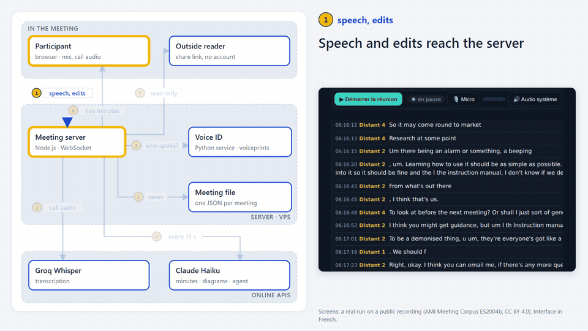

[English](README.md) · **Français**

# Agent de réunion

**Transcrit la réunion, distingue les voix et tient le compte-rendu au fil de l'eau ; les participants le corrigent en direct.**

Animation en français

*Vrais écrans d'un passage sur un enregistrement public (AMI Meeting Corpus, CC BY 4.0). [Vidéo complète (1:12)](https://drive.google.com/file/d/1R6aO1uMWa2q5uhz4WAEHl5KpXPpiFBeC/view)*

## Ce qu'on en fait

- **Transcription en direct.** Le micro est transcrit dans le navigateur, le son de la visio par Whisper ; chaque ligne est horodatée. Les voix distantes sont distinguées par empreinte vocale et se renomment une fois pour toute la réunion.
- **Compte-rendu en direct.** Un résumé, des décisions actées, reportées ou rejetées, des actions avec un seul responsable et une échéance jamais inventée. Chaque point cite la ligne de transcription qui le justifie ; un point sans source est signalé.
- **Corrections.** Chacun réécrit, supprime ou ajoute une ligne. Une ligne corrigée est verrouillée pour l'agent, et la correction lui revient comme une règle à suivre.
- **Conseil ou consigne.** Deux champs : *Conseil* répond aux questions sans rien changer ; *Consigne* modifie le compte-rendu ou le schéma.
- **Schémas.** L'agent ouvre un schéma quand quelqu'un décrit un système ou un processus, une fenêtre par sujet.
- **Partage.** Un lien montre le compte-rendu et les schémas en direct, en lecture seule, sans compte ; la transcription, la liste des connectés et le coût ne sont pas partagés. Export PDF.

## Architecture

Diagramme en français

## État

- **Usage.** Vraies réunions de l'été à novembre 2026 ; projet arrêté le 3 novembre 2026, service hors ligne.
- **Identification des voix.** Améliorée sur un banc rejouable, tiré d'une réunion publique dont on connaît les locuteurs (AMI ES2004a) : de 40 identités à 6 pour 4 personnes, pureté de 63 % à 76 %. Ignorer les tours de moins d'une seconde a été le plus gros gain.
- **Technique.** Node.js et WebSocket dans Docker, une seule page sans framework, Groq Whisper large-v3, Claude Haiku 4.5 ; empreintes vocales dans un service Python sur le même serveur (sherpa-onnx, ERes2NetV2).

---

**Anthony Hunt** · [ingevision.cloud](https://ingevision.cloud/?p=meeting-agent) · [LinkedIn](https://www.linkedin.com/in/anthony-hunt-3948a9196) · [GitHub](https://github.com/anthohunt)

Le code est privé.
