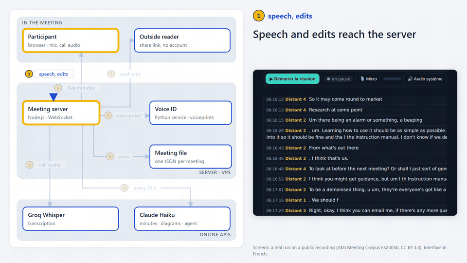

**English** · [Français](README.fr.md)

# Meeting agent

**Transcribes a meeting, tells the voices apart and keeps the minutes as it goes; the participants correct them live.**

*Real screens from a run on a public recording (AMI Meeting Corpus, CC BY 4.0). Interface in French. [Full video (1:12)](https://drive.google.com/file/d/1FN3gNw2EwRfOlKvlhFLsDuzwxr85LI55/view)*

## Using it

- **Live transcript.** The microphone is transcribed in the browser, the call's audio by Whisper; every line is time-stamped. Remote voices are labelled by voiceprint and can be renamed once for the whole meeting.
- **Live minutes.** A summary, decisions marked agreed, postponed or rejected, actions with one owner and a deadline that is never invented. Each item cites the transcript line behind it; an unsourced item is flagged.
- **Human edits.** Anyone rewrites, deletes or adds a line. An edited line is locked against the agent, and the correction goes back to it as a rule to follow.
- **Advice or instruction.** Two inputs: *Advice* answers questions without changing anything; *Instruction* edits the minutes or the diagram.
- **Diagrams.** The agent opens a diagram when someone describes a system or a process, one window per topic.
- **Sharing.** A link shows the minutes and diagrams live, read-only, without an account; the transcript, who is online and the cost are not shared. PDF export.

## Architecture

## Status

- **Use.** Real meetings from summer to November 2026; project stopped on 3 November 2026, service offline.
- **Voice ID.** Improved on a replayable bench built from a public meeting with known speakers (AMI ES2004a): 40 identities down to 6 for 4 speakers, purity 63% → 76%. Ignoring turns under one second was the biggest gain.
- **Stack.** Node.js and WebSocket in Docker, one page without a framework, Groq Whisper large-v3, Claude Haiku 4.5; voiceprints in a Python service on the same server (sherpa-onnx, ERes2NetV2).

---

**Anthony Hunt** · [ingevision.cloud](https://ingevision.cloud/?lang=en&p=meeting-agent) · [LinkedIn](https://www.linkedin.com/in/anthony-hunt-3948a9196) · [GitHub](https://github.com/anthohunt)

The code is private.
