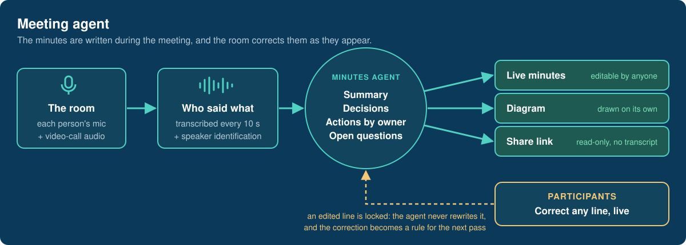
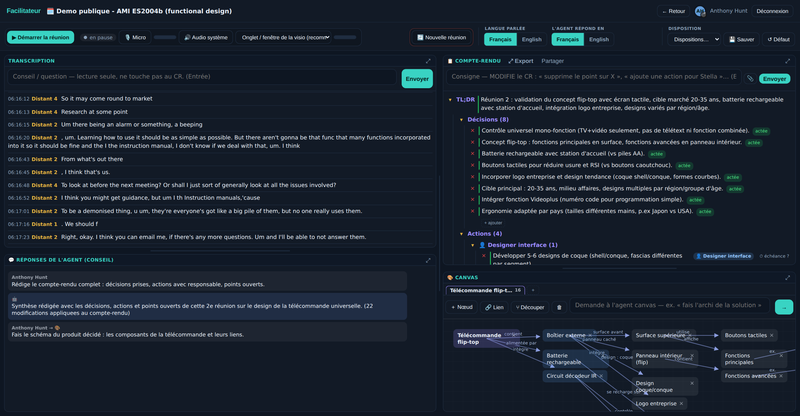
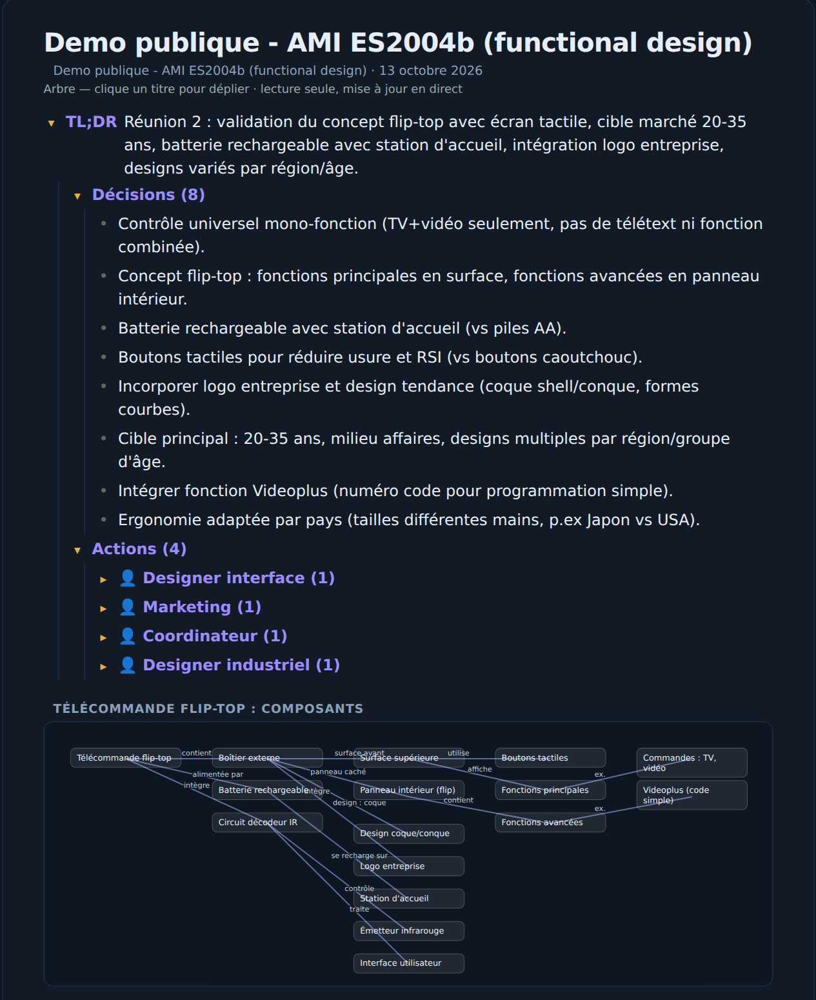
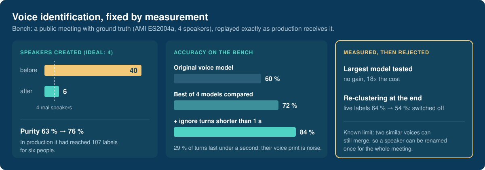

# Meeting agent

**A live meeting agent: it transcribes who said what, writes the minutes and draws the system being discussed while the meeting happens, and the people in the room correct it as it goes.**

## Why

Transcription is solved; minutes are not. A summary written after the meeting arrives too late, and nobody who could correct it is still in the room. Here the minutes are built on screen during the meeting, anyone can edit any line, and the agent never overwrites what a person touched.

## The product

**1. The live screen.** Attributed transcript on the left; minutes and diagram on the right, updated as people speak. One field advises without touching the minutes, the other gives the agent instructions it applies.

**2. The share link.** Outsiders follow the minutes and the diagram live, read-only. The transcript, the attendee list and the cost never leave the room.

A real run on a public research recording (AMI Meeting Corpus, ES2004b: four people designing a remote control, 39 minutes, CC BY 4.0), so the demonstration contains no client material. The interface is in French. The action owners (designer, marketing, coordinator) were inferred from the discussion: nobody states their role in the recording.

## The evidence

**Speaker identification was repaired by measurement, not by a bigger model.** In production it was creating more than a hundred voice labels for six people. The failure was reproduced on a public meeting with ground truth, then each fix was kept or dropped on the numbers.

The bench and its fixtures are versioned with the project so the measurement can be replayed.

## Design principles

| | |
|---|---|
| **The human edit is final** | An edited line is locked on the server; no prompt can undo it. |
| **Corrections become rules** | Each edit is fed back to the agent as an instruction to generalise, so a mistake is made once. |
| **Advise and act are separate** | One channel only answers questions; only the other may change the minutes. |
| **Measure before changing** | Speaker identification is tuned on a replayable bench, never on impressions. |
| **State the limits** | Two similar voices can still merge, so a speaker can be renamed once for the whole meeting. |

## Status

Used for real meetings since summer 2026. Private service; a live demonstration is available on request.

Stack: Node.js and WebSocket in Docker behind Traefik · Whisper large-v3 for transcription · a separate speaker-identification service (3D-Speaker embeddings on ONNX Runtime) · live cost tracking per meeting · PDF export.

## Why the source is not here

The running system is private. This page shows what it does, how it is built and the reasoning behind the decisions that mattered. Happy to walk through any of it in detail with anyone evaluating a collaboration.

---

**Anthony Hunt** — applied agentic AI: evaluating, training and deploying specialised agents.
[GitHub profile](https://github.com/anthohunt) · [anthony.hunt@yahoo.fr](mailto:anthony.hunt@yahoo.fr)

Demonstration data: AMI Meeting Corpus, University of Edinburgh, CC BY 4.0. © 2026 Anthony Hunt. The described system is proprietary.
