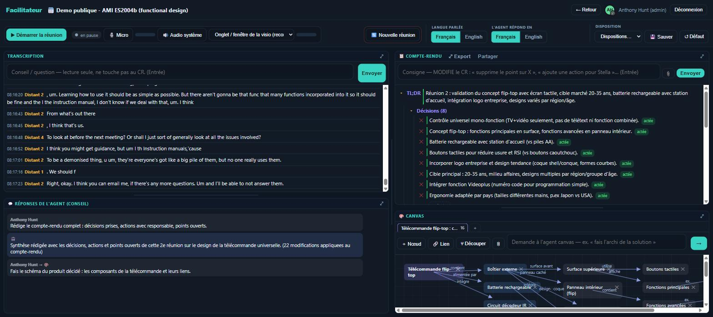
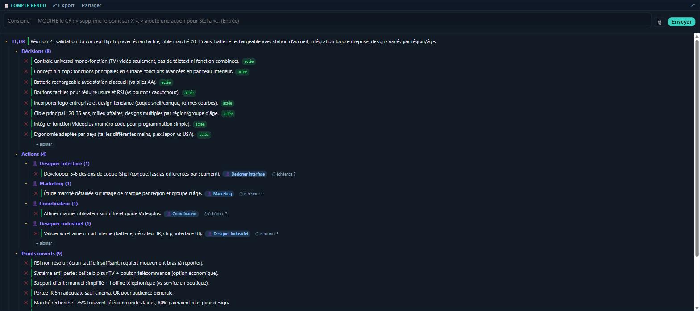
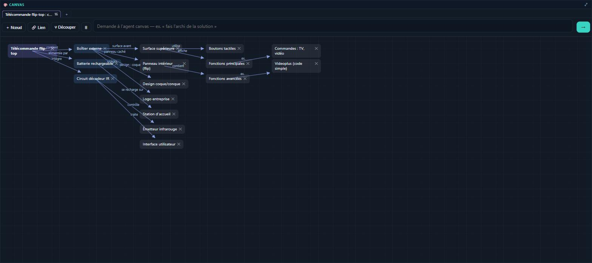

# Facilitateur

**A live meeting agent: it listens, attributes every turn to a speaker, writes the minutes as the meeting happens, and draws the system being described — while the room corrects it in place.**



*Above: a real meeting processed end to end. The transcript is the [AMI Meeting Corpus](https://groups.inf.ed.ac.uk/ami/corpus/) (ES2004b, functional design, four participants, 39 minutes, CC BY 4.0) — a public research recording, used here so the demonstration contains no client material.*

---

## The problem

Meeting transcription is solved. Meeting *minutes* are not.

A transcript is a wall of text nobody reads. An LLM summary written after the fact is unfalsifiable and arrives too late to change anything. And both share the same defect: they are produced *about* the meeting rather than *during* it, so the people who know the answer never get to correct them while it matters.

Facilitateur inverts that. The minutes are built live, on screen, and anyone in the room can edit any line as it appears — with the guarantee that the agent will never overwrite what a human touched.

## What it does

| | |
|---|---|
| **Listens** | Captures each participant's microphone and the system audio of the video call, in 10-second windows. |
| **Attributes** | Identifies remote speakers by voice, so every turn carries a name and a real timestamp. |
| **Writes** | Maintains a structured record — a one-line summary, decisions, actions grouped by owner, open questions — continuously, not at the end. |
| **Draws** | When someone describes a system, product or process, a diagram appears on its own. |
| **Obeys** | Two separate agent channels: one that only advises, one that acts on the minutes when instructed. |
| **Shares** | A read-only public link shows the live minutes and diagram to outsiders — never the transcript, the presence list, or the cost. |



The minutes above were produced from the transcript alone. Note that the actions are grouped under **Designer interface, Marketing, Coordinateur, Designer industriel** — roles the agent inferred from the discussion; nobody in the recording ever announces their job title.



The diagram was generated on request from the same conversation: sixteen components with named relations — *contains, powered by, integrates, recharges on, controls*.

## Engineering decisions worth stealing

**The human correction is law.** An item a person edits is flagged, and the summarising agent is structurally forbidden from rewriting it — enforced server-side, not by prompt. Without this, every regeneration silently undoes the room's work, and people stop trusting the screen within minutes.

**Corrections become rules, not just edits.** Each human change is fed back into the next synthesis pass as an instruction that carries authority, with the agent told to generalise the implicit rule rather than patch the single line. The tool gets the room's style wrong once, not repeatedly.

**Voice identification was fixed by measurement, not by a bigger model.** The live system was producing *107 identities for six people*. Rather than guess, the failure was reproduced on a public meeting with ground truth, remixed to match production conditions exactly — one microphone at a time, the way a video-call bridge transmits. Four embedding models were compared on identical audio. The verdict:

| | identities (ideal: 4) | purity |
|---|---|---|
| before | **40** | 63 % |
| after | **6** | 76 % |

The single most profitable change was not the model but **discarding turns shorter than one second** — 29 % of all detected turns, whose voice prints are noise. That alone moved accuracy from 72 % to 84 %. The largest model tested (ResNet293) was rejected: no gain, eighteen times the cost.

**The remaining limit is stated, not hidden.** Two similar voices still merge occasionally. On a mixed audio stream, voice alone plateaus — the next profitable step is letting a human rename a speaker once for the whole meeting, not buying a heavier model.

**One template, no drift.** Every published page is served from a single root template; only the data is per-meeting. A visual fix is made once and propagates everywhere in one command.

## Architecture

```
each phone's mic  ─┐
video-call audio  ─┴─► 10s windows ─► transcription ─┬─► attributed turn ─► live screen
                                     voice ID ───────┘
                                                      │
                                            structured minutes agent
                                             (never overwrites edits)
                                                      │
                              ┌───────────────────────┼───────────────────┐
                        live minutes            auto diagram        read-only share link
                              │
                    human edits ──► authority feedback ──► next synthesis pass
```

**Stack** — Node.js + WebSocket in Docker behind Traefik · Whisper large-v3 for transcription · a separate voice-identification service (3D-Speaker embeddings, ONNX runtime) · live cost accounting per meeting · PDF export.

## Status

In production, used for real meetings. The measurement bench for voice identification is versioned with the project, including the fixtures and the commands to replay it.

## Why the source is not here

The running system is private. This repository documents what it does, how it is built, and the reasoning behind the decisions that mattered.

Happy to walk through any of it in detail with anyone evaluating a collaboration.

---

**Anthony Hunt** — independent consultant, applied agentic AI.
Multi-agent systems in production · LLM orchestration · AI × immersive.
📧 [anthony.hunt@yahoo.fr](mailto:anthony.hunt@yahoo.fr)

Demonstration data: AMI Meeting Corpus, University of Edinburgh, licensed CC BY 4.0.
© 2026 Anthony Hunt. The described system is proprietary.
